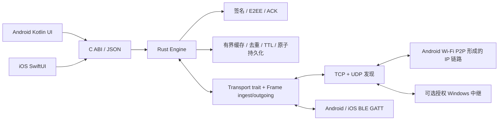

# 架构与协议 v1

## 调度与传输

Rust `Transport` 定义可替换的交换边界。`TcpTransport` 实现双向反熵同步；原生 BLE 通过同一 C ABI 的 `ingest` / `outgoing` 接入，所有转发与去重继续由 Rust 完成。无虚假发现列表、假消息传递或云后备。CLI 和移动端共享同一个真实 TCP Runtime。

TCP：监听 IPv4，默认端口 37078。客户端发送已见 ID 清单、读取对端清单，然后发送最多 24 个对端缺少的封装、读取对端封装。服务端顺序相反避免大包互写死锁。每个 JSON 包前有 4 字节网络字节序长度，最大 2 MiB；每帧最大 64 KiB。读写 timeout 2 秒，拨号 timeout 500 ms。当前服务端串行接受连接，客户端串行遍历邻居；不是 300 节点吞吐优化版本。

UDP：Android/CLI 可在 37077 端口每约 5 秒广播 `CM1 <fingerprint> <TCP port>`，从数据包源 IP 得到地址。广播不建立信任，不用于自动添加好友；发现项 60 秒过期，手动邻居持久化并持续重连。最多 300 邻居。同步一轮耗时会延长实际广播周期。当前没有 IPv6 / Bonjour；iOS 默认不启用 UDP 广播，避免依赖 Apple multicast 特殊 entitlement。

BLE：相同 service UUID `b8554a10-6a9a-4c18-ae32-32a3bc1d0010`，DATA UUID 的第一段改为 `b8554a11`。DATA 支持有响应写入及 notify。中心订阅 CCC 后双向发送：中心 write→外设，外设 notify→中心。流格式为 4 字节大端长度 + UTF-8 Frame JSON，兼容最低 ATT MTU 的 20 字节分块，每连接独立收发缓冲。超出 65536 字节拒收，接收停顿 30 秒清理缓冲。GATT 写入成功不等于端到端交付。最多四条中心连接及四个订阅者；双角色可能产生重复链路，核心负责去重。

BLE 每 5 秒在空闲链路发送一个待传封装，以循环游标避免永久只发缓存前部。核心返回一个共享轮转批次给所有活跃 BLE 链路。BLE 暂未做 inventory 优化、MTU 提速、RSSI 路由或可靠拥塞控制。待传多时延迟较高。TCP 与 BLE 可并行发送同一消息，由签名 ID 去重；当前使用并行机会式传输，而非质量评分选路。

Android Wi-Fi Direct 使用系统 `WifiP2pManager` 发现与连接，不修改系统权限。群客户端把系统返回的 owner IP 加入 TCP 邻居；群主接受客户端的双向同步。Wi-Fi Direct 是 IP 承载，不是可任意桥接的多群无线 Mesh。iOS 无对等公共 API，跨平台通过 BLE 或普通局域网。

## Gossip / DTN

封装存储在本机，接触邻居时传播，设备离开后继续携带。断网、分裂不立即报发送失败。重接触时交换 inventory 后续传；核心不要求端到端路径同时存在。

每条消息默认有效 24 小时、最多 8 跳。`hops=0` 由源设备发出，每次中继增加 1。目的设备解密并生成独立的加密 ACK，ACK 走同一多跳/携带路径。源设备只有验证预期目的身份的 ACK 才标记 `delivered` 并移除自己的密文。其他中继仍可能保留密文到过期；未实现网络范围删除。

ID 为发送者公钥 SHA-256 指纹 + `:` + 128 位随机值，防止其他身份复用 ID 污染去重表。先验签，再去重、解密或缓存。去重窗口持续到原封装过期，持久化随状态保存。重复到达不重复生成聊天记录。未知发送者可经过中继，但收件人必须先明确添加发送者公钥；私聊不受信任时，该帧不进入收件人的已见表，添加好友后可重试。新群消息通过群主签名的名册确认发送者，群控制消息按各自授权规则处理。

容量：最多 4096 个待传封装、约 8192 个已见 ID、1000 个联系人、10000 条聊天记录。文本最多 8192 UTF-8 字节、群标识最多 128 字节。满缓存返回错误，不会为新消息偷偷删除尚未交付的旧消息。状态文件以私有权限 0600 写入临时文件，fsync 后 rename；Unix 同步父目录。独占文件锁阻止两个应用实例同时覆盖身份。损坏状态文件启动失败，不生成替代身份。应用删除或丢失状态文件会丢失身份与记录。

## 密钥与认证

Ed25519：长期签名身份；指纹为签名公钥的 SHA-256。X25519：长期收件密钥；每个封装生成新的发送方临时密钥。双方共享值经 HKDF-SHA256 派生密钥，用 XChaCha20-Poly1305 加密文本/群标识或 ACK，随机 192 位 nonce。依赖 RustCrypto、dalek、操作系统 CSPRNG，拒绝无贡献 X25519 共享值。

所有封装字段（除可变的实际跳数）参与 Ed25519 严格验签；AEAD 附加数据绑定协议、消息 ID、发送者与收件人。好友二维码提供签名/收件公钥及昵称，要求当面核对；后续同一签名公钥但不同收件密钥的封装被拒绝。中继只掌握密文，无收件私钥。传输不额外使用 TLS；不隐藏通信元数据。

此方案不是 Signal Double Ratchet：收件长期私钥泄漏可解密此前捕获的封装，无前向保密、密钥轮换/撤销及加密备份。帧级身份认证不等于已认证的链路会话。陌生身份仍可消耗中继资源；上线前需要速率限制、准入、外部密码学评审与无线 DoS 测试。可变跳数是诚实节点的资源限制，恶意中继能重置它，不能把它视为密码学安全边界。

## C ABI

- `cm_open(private_path, nickname, port, discovery)` → 不透明 handle，失败返回 null。
- `cm_call(handle, json)` → `{ok,data}` 或 `{ok:false,error}`；UTF-8，返回字符串调用 `cm_free` 释放。
- `cm_close(handle)`：停止工作线程、释放 runtime，只调用一次。
- 同一 handle 的调用与关闭必须串行。Kotlin 使用同步入口；Swift 在主执行器调用，Rust 网络线程只在操作 Engine 时持锁，网络 I/O 不持锁。

命令：`state`、`profile`（修改昵称）、`contact_card`、`scan`、`friend_remark`、`settings`、`group_create`、`group_edit`、`group_invite`、`group_sync`、`group_leave`、`group_send`、`group_migrate`，以及兼容导入的 `contact`、私聊 `send`、`peer`、`relay`、`ingest`、`outgoing`。`send` 不再接受本机群发标签，新界面统一调用 `group_send`。`outgoing` 是循环分页，默认最多 24，BLE 指定 `limit:1`。`state` 不返回私钥，也不反复写磁盘。`send`/`contact`/`peer`/`relay` 等修改在返回成功前保存；网络接收同样在同步完成前保存。手动 peer 用 IP:port 字符串，暂不支持主机名、删除 UI 或网络变更后的 IP 自动纠正。

## alpha-0.5.0 好友与群协议

设备 ID 延续已有签名公钥指纹，保存在原 `mesh.json`，不重建身份。好友卡类型为 `campusmesh.contact`，版本 1，包含 `device_id`、公开 `Contact` 和 Ed25519 自签名；验签时将签名字段置空后按固定结构序列化。好友备注和添加时间单独保存，不进入公开二维码。`state.contacts` 额外提供 `device_id`、`remark` 和 `display_name`，同时保留真实 `nickname`。

群 ID 为群主设备 ID、冒号与 128 位随机数。成员列表使用按设备 ID 排序的映射，群主、名称、递增版本、解散状态及成员公钥共同参与群主签名。共享记录最多 32 位成员、本机最多 64 个群。本机 `joined` 不在群主签名内，防止旧快照撤销主动退群。新群快照只接受已信任好友群主或本机待处理邀请对应的群主；已有群禁止回退版本或替换群主密钥。

群控制事件位于端到端加密 Payload 的 `group_event` 中：`snapshot` 分发名册，`join` 携带短期单次邀请，`leave` 请求退群，`sync` 向群主请求最新快照。`campusmesh.group` 邀请二维码只携带群主、群 ID、名称、随机 nonce、到期时间与签名；群主保存 nonce，完成入群时消费。二维码不随成员数量增长，默认 600 秒有效。同群重新生成会撤销旧 nonce。陌生人只有持有效邀请才能请求入群，入群不会自动加入私聊联系人。

新群消息包含 `group`、`group_revision` 和 `group_message_id`。接收者校验发送者的签名及交换公钥属于当前成员，拒绝高于本地名册的消息版本；同步名册后可重试。移除和解散由新快照在送达的设备上生效。长期离线错过快照时，当前成员可通过 `group_sync` 恢复；没有即时全网撤销或历史同步。

发送事务先检查完整容量，再逐成员生成独立密文封装；任何成员封装失败均回滚整个发送。一条本机逻辑记录保存每位接收者状态，内部映射绑定封装 ID、逻辑消息 ID 和预期收件人，阻止其他群成员代为确认。回执聚合为 `queued`、`partially_delivered` 或 `delivered`，到期后未确认部分显示 `expired`。群成员变更同样在事务内执行；移动端修改命令在原子保存成功后才返回成功，保存失败会恢复内存状态。

`MeshSettings` 保存在原状态文件，旧文件自动采用默认参数：8 跳、86400 秒、5 秒同步、每批 24、最多 300 TCP 邻居和 4096 待传封装。范围和传输差异见[参数表](FRIENDS-GROUPS.md#mesh-详细参数)。接收端保留 8 跳、24 小时和 24 帧的协议硬上限，较小本机设置限制自己新建及发送的封装。BLE 保留单帧轮转和每侧 4 条连接上限。

旧客户端仍能转发新封装，不能作为新群成员参与。核心保留旧线格式解析以便读取历史，防止旧群标签注入新固定 ID 群聊；移动端不再生成旧式群发。`group_migrate` 维护旧名称到新 ID 的幂等映射，并重写本机相关历史分组，移动端随后迁移草稿、移除成功迁移的旧组合。
